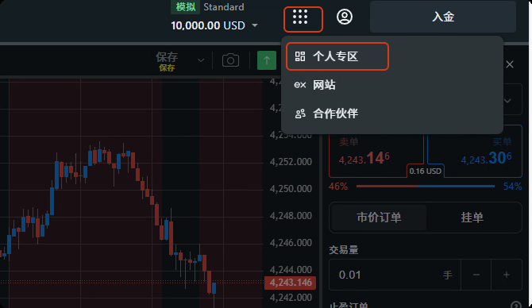
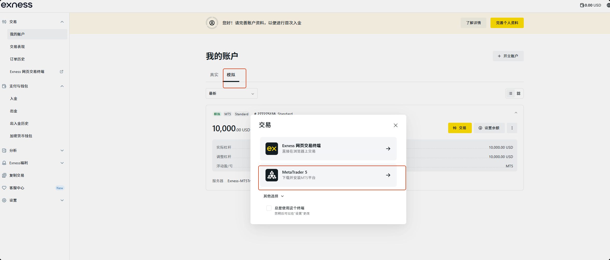

# EasyDeal 社区版 · 让 AI 帮你看懂并值守 MT5 交易

就算有一套完全自动赚钱的工具，你也会经常盯着它。你跟专业交易员对比，差别在于是否看得懂。EasyDeal 就是解决这个问题的桌面客户端：它把 AI 接到你本机的 MT5，帮你监控策略执行、解答问题、在异常时提醒你，甚至帮你修改策略代码。

社区版是免费开源的**单机版**：不需要序列号，交易数据只留在你的电脑上。

> **交易风险提示：** 外汇和贵金属保证金交易风险很高。内置的 GMarket 策略包含对冲和马丁加仓逻辑，可能在剧烈波动、点差扩大、流动性不足或连续不利行情中产生快速且显著的亏损。请先在模拟账户和策略测试器中验证，并自行设置手数、最大亏损、周盈亏限制，只投入能承受损失的资金。本项目不构成投资建议，也不保证收益。

## 下载安装

到 [Releases](https://github.com/xszyou/Easy-Deal/releases) 下载最新的 `EasyDeal-Community-x.y.z-x64-setup.exe`，双击安装即可。安装包已内置 Python 运行时和 Claude Code，不需要另外配置环境。

系统要求：Windows 10 / 11（64 位），本机已安装 MT5。

## 联系我们

加入交流群一起讨论策略与踩坑：


加入知识星球，获取更深入的策略分享和答疑：


## 功能

| 标签页 | 说明 |
|---|---|
| AI | 全局会话和每个策略的专属会话；支持附件和截图，AI 会记下每个策略的经验笔记 |
| MT5 | 管理多个 MT5 实例：发现、启动、停止和身份校验 |
| 策略 | 策略列表、本地成绩单、参数与热参数、挂载和卸载、编译、依赖指标、复制策略 |
| 护航 | 给 EA 上一层风控：监控模式无需改 EA 源码；拦截模式可挡高风险的开仓、改单和平仓；可结合快讯和经济日历审批马丁加仓（实验性功能） |
| 监控 | 定时 AI 巡检，一个任务可绑定多个策略，策略停跑时自动跳过 |
| 教程、资讯 | 视频教程、金十快讯、经济日历和散户情绪 |
| Skills | MCP 工具清单、本机 Claude Skills、帮助文档 |
| Token | 选择 AI 通道：本机 Claude 登录、自定义端点（Anthropic 或 OpenAI 协议）、Codex |

安装后自带 **GMarket v1.082**（编译后的 `.ex5` 和策略说明），在「策略」页点「挂载」即可装进 MT5。

内置知识库里自带 [用户手册](docs/用户手册.md) 和 [《ML4T 中文导读》](docs/ML4T中文导读.md)（Stefan Jansen《Machine Learning for Trading》第 3 版的通俗导读），AI 回答使用问题和量化研究方法问题时会参考它们。AI 可用的下单工具（开仓、平仓、改单）默认关闭，需要在设置里手动打开。

**还没有 AI 模型？** 在「Token」页点「查看火山引擎注册指引」，按指引开通后把 API Key 填进「自定义端点」。指引中的注册链接带有开发者的推荐码，通过它注册购买，开发者会获得推荐奖励，你的价格不受影响。

📖 **完整的使用说明见 [用户手册](docs/用户手册.md)**：每个页面怎么用、怎么做策略、怎么配护航和定时巡查、常见问题和已知问题。

---

# 一、交易账号注册与 MT5 安装

- 访问 exness 官网（需要开启 VPN，VPN 不能使用美国、伊朗、朝鲜、欧盟、英国）：https://one.exnessonelink.com/a/r6fx3vgje1

- 点击右上角登录 --> 开立账户 --> 注册 --> 个人专区

  - 

- 我的账户 --> 模拟 --> 交易 --> Meta Trader 5（此处保存好交易账号信息及服务器信息）--> 下载安装 MT5 平台 --> 运行 exness5setup.exe --> 等待安装完成

  - 
  - 

- 运行 MT5 终端 --> 关闭开设账户弹窗 --> 导航栏 --> exness --> 账户 -- 右键 --> 登录到交易账户（注意，此处填写的登录名为上文选择 mt5 交易时记录的那串数字账号，服务器也需注意选择正确）

开户链接带有开发者的推荐码。请确认你所在地区允许参与外汇和贵金属保证金交易。

---

# 二、MT5 开启算法交易


EA 要在 MT5 里自动下单，必须先开启算法交易。

## 打开交易窗口


右键点击交易品种“XAUUSD”，选择“图表窗口”，即打开了如图所示图表。

## 开启算法交易


把 EA 附加到图表时请勾选允许算法交易，并点击 MT5 上方的算法交易按钮。成功后可以看到策略窗口。非交易日没有行情报价时 EA 不会运作，附加后等待交易时间即可。

## 不用客户端，只跑 EA


`bundled-eas/GMarket.ex5` 也可以单独使用：点击 MT5 菜单栏的“文件”→“打开数据文件夹”，打开 `MQL5\Experts`，复制 `GMarket.ex5` 后返回 MT5 导航栏刷新专家列表，再按上面的步骤附加到图表。策略说明见 [`bundled-eas/GMarket.md`](bundled-eas/GMarket.md)。

---

# 三、客户端快速上手

1. 到 [Releases](https://github.com/xszyou/Easy-Deal/releases) 下载安装包并安装。
2. 打开「Token」页选择 AI 通道。已经登录过 Claude Code 的直接用「系统」；否则按「购买 Token」卡片的指引开通火山引擎，填进「自定义端点」。
3. 打开「MT5」页点「+ 添加实例」，选择 MT5 的程序目录和数据目录。还没有交易账户的，切到「还没有交易账户？」按步骤开户。
4. 打开「策略」页，找到内置的 GMarket，选好 MT5 实例后点「挂载」，再按第二节开启算法交易。
5. 回到「AI」页，问它“帮我看看 GMarket 现在运行得怎么样”。也可以在「设置 → 关于」点「AI 指引配置」，让 AI 一步步带你配置。

更多玩法（让 AI 写策略、给 EA 上护航、设定时巡查）见 [用户手册](docs/用户手册.md)。

---

# 四、从源码运行和打包

需要 Windows 10/11、Node.js 20+、Python 3.11+：

```bash
npm install
pip install -r python/requirements.txt
npm start
```

打包安装程序前，先运行 `scripts/setup-python-runtime.ps1` 生成内置的 Python 运行时，再运行 `npm run dist:win`。

---

# 许可证

源代码以 [GPL-3.0](LICENSE) 发布。`bundled-eas/GMarket.ex5` 是编译后的策略文件，不附带源码。
